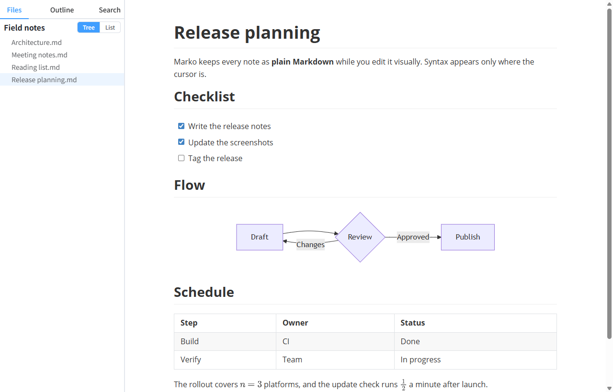
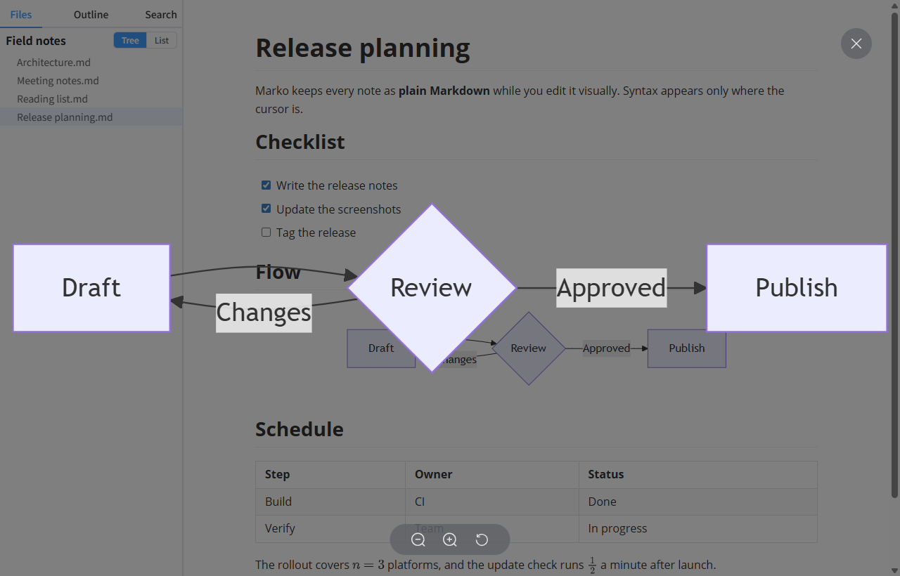

<p align="center">
  
</p>

<h1 align="center">Marko</h1>

<p align="center">
  <strong>A modern, local-first Markdown editor built for uninterrupted writing.</strong>
</p>

<p align="center">
  Write in one continuous visual surface while keeping every document as portable, plain Markdown.
</p>

<p align="center">
  <strong>English</strong>
  ·
  <a href="./README.zh-CN.md">简体中文</a>
</p>

<p align="center">
  <a href="https://github.com/chain-code/Marko/releases/latest">
    
  </a>
  <a href="./LICENSE">
    
  </a>
  
  
  
  
</p>

<p align="center">
  <a href="https://github.com/chain-code/Marko/releases/latest"><strong>Download Marko 2.0.0</strong></a>
  ·
  <a href="#features">Features</a>
  ·
  <a href="#development">Build from source</a>
</p>



Marko combines visual editing with the durability of plain Markdown. Formatting stays rendered while you read, and the Markdown syntax appears only where you are editing. Files, folders, search, tables, diagrams, math, images, and export tools live in one focused desktop workspace.

Marko 2.0 is a rewrite: the desktop app now runs on Electron, and the editor is a new engine built on ProseMirror (Tiptap). It is available for Windows 10/11 x64, Apple Silicon Macs running macOS 13 or later, and Linux x64.

## Why Marko?

- **Stay in the document** - Write in one continuous editing surface instead of switching between source and preview panes.
- **Keep control of your files** - Work with ordinary local Markdown files and folders, with autosave, draft recovery, and external-change detection.
- **Edit rich content directly** - Edit tables, code, math, and diagrams in place, and manage images without leaving the document.
- **Stay fast on long documents** - A document of about 100,000 characters opens in roughly 0.2 seconds, and typing stays responsive.

## Diagram and image viewer

Large architecture, process, and sequence diagrams quickly outgrow a document column. Marko renders Mermaid, Flowchart, and Sequence blocks inline, then lets you **double-click any rendered diagram or image to open it in a full-window viewer**.



- Zoom in, zoom out, or reset from the toolbar.
- Zoom with the mouse wheel and drag to pan.
- Use `+`, `-`, and `0` from the keyboard.
- Inspect details from 40% to 300% without changing the Markdown source.
- Press `Esc` to return to the document.

| Diagram interaction | Marko | Typora 1.13.7 |
| --- | --- | --- |
| Inline Mermaid, Flowchart, and Sequence rendering | Yes | Yes |
| Double-click full-window viewer for diagrams and images | **Built in** | Not available |
| Zoom toolbar and reset | **Built in** | Not available |
| Mouse-wheel zoom and drag to pan | **Built in** | Not available |
| Keyboard zoom and instant `Esc` close | **Built in** | Not available |

The comparison above refers to the default desktop behavior observed in Typora 1.13.7. Marko is an independent project and is not affiliated with Typora.

## Download

Download installers, checksums, and release notes from [GitHub Releases](https://github.com/chain-code/Marko/releases/latest).

| Platform | Requirements | Release package |
| --- | --- | --- |
| Windows x64 | Windows 10 or 11 | NSIS `.exe` installer |
| macOS ARM64 | macOS 13+ on Apple Silicon | `.dmg` or `-mac.zip` |
| Linux x64 | A recent x64 distribution | `.AppImage` or `.deb` |

SHA-256 checksum files are published alongside the installation packages. Once installed, Marko downloads new versions in the background and asks you to restart when an update is ready.

> [!IMPORTANT]
> Marko 2.0 does not import settings, recent files, or drafts from 1.x. Save all documents before upgrading.

> [!NOTE]
> If the macOS package is unsigned, macOS may ask for confirmation in **System Settings > Privacy & Security** the first time you open it, and automatic updates are not available on macOS; download new versions from GitHub Releases.

## Features

| Area | What Marko provides |
| --- | --- |
| Continuous visual editing | Rendered content with Markdown syntax shown where you edit, cross-block selection, undo that groups typing, and a full source mode |
| Markdown | Headings, quotes, links, task lists, footnotes, abbreviations, YAML Front Matter, `[TOC]`, GitHub-style callouts, and raw HTML |
| Technical content | Syntax-highlighted code, MathJax math with numbering, Mermaid, Flowchart, and Sequence diagrams, highlights, superscript, and subscript |
| Tables | Direct cell editing, row and column operations, alignment, and `Tab` / `Shift+Tab` navigation |
| Images and media | Paste and drag images, copy them next to the document or upload them, set widths, embed video and audio, and open a large viewer |
| Files and workspaces | One window per document, file tree and file list, outline, quick open, recent files, workspace search, local links, and session restore |
| Encodings | Automatic encoding detection, reopening with another encoding, and BOM and line-ending preservation |
| Focus and safety | Focus mode, typewriter mode, full screen, zoom, spell checking with a user dictionary, autosave, draft recovery, and unsaved-change confirmation |
| Export and import | HTML, PDF, long images, and printing built in; Word, OpenDocument, RTF, EPUB, LaTeX, reStructuredText, and MediaWiki through Pandoc, with diagrams exported as images; import through Pandoc |
| Appearance | Light and dark built-in themes, following the system appearance, and Typora-compatible custom themes |
| Personalization | Customizable shortcuts, Chinese and English interfaces |

HTML, PDF, image export, and printing work without extra software. Formats exported through Pandoc require a local [Pandoc](https://pandoc.org/) installation.

<details>
<summary><strong>Common keyboard shortcuts</strong></summary>

`Ctrl` corresponds to `Command` on macOS. Every shortcut can be changed in **Preferences > Shortcuts**.

| Action | Shortcut |
| --- | --- |
| New / Open / Save | `Ctrl+N` / `Ctrl+O` / `Ctrl+S` |
| Save as | `Ctrl+Shift+S` |
| Quick open | `Ctrl+P` |
| Find / Replace | `Ctrl+F` / `Ctrl+H` (`Command+Option+F` on macOS) |
| Search workspace | `Ctrl+Shift+F` |
| Source mode | `Ctrl+/` |
| Toggle sidebar | `Ctrl+Shift+L` |
| Focus / Typewriter mode | `F8` / `F9` |
| Full screen | `F11` (`Control+Command+F` on macOS) |
| Print | `Shift+Alt+P` |

</details>

## Development

<details>
<summary><strong>Requirements, local development, testing, and packaging</strong></summary>

### Requirements

Node.js 24 and npm 10 or later. No other toolchain is needed: Electron, ripgrep, and the native file watcher are installed by npm.

### Run locally

```bash
npm ci
npm run dev
```

`npm run dev` starts the Electron app with hot reload.

### Test

```bash
npm run check             # type checking and dependency rules
npm test                  # unit tests, behavior specs, and component tests
npm run test:e2e          # end-to-end tests on the built app
npm run test:interaction  # editor interaction tests in Microsoft Edge
npm run test:e2e:packaged # end-to-end tests on a packaged app
```

### Build

```bash
# Unpacked app for the current platform
npm run pack

# Installers for the current platform
npm run dist
```

Packages are written to `apps/desktop/release`. Each platform is built on its own operating system; the release workflow builds Windows, macOS, and Linux packages when a version tag is pushed.

### Project layout

| Path | Contents |
| --- | --- |
| `packages/markdown` | Markdown parsing, the document model, and lossless serialization |
| `packages/render` | HTML rendering, sanitizing, math, highlighting, diagram sandbox, and self-contained export |
| `packages/editor` | The editor engine as Tiptap extensions |
| `packages/editor-vue` | The Vue editor component and its overlays |
| `packages/themes` | Base, editor, and interface styles and the built-in themes |
| `packages/shared` | Settings, shortcuts, and the interface between processes |
| `apps/desktop` | The Electron app: main process, preload script, and interface |

</details>

<details>
<summary><strong>Technology stack</strong></summary>

- Electron, Vue 3, TypeScript, Element Plus, and electron-vite
- Tiptap (ProseMirror), CodeMirror 6, and Lezer Markdown
- MathJax, Mermaid, flowchart.js, and @hackmd/js-sequence-diagrams
- electron-builder and electron-updater
- Vitest, Vue Test Utils, Playwright, and dependency-cruiser

</details>

## Contributing

Issues and pull requests are welcome. When reporting a problem, include the Marko version, operating system, a minimal Markdown example, clear reproduction steps, and a screenshot or short recording when the behavior is visual.

Before submitting a pull request, run:

```bash
npm run verify
```

Please keep changes focused and add regression coverage for behavior changes. The architecture is documented in [docs/architecture.md](./docs/architecture.md), and the full feature list in [docs/features.md](./docs/features.md).

If Marko improves your writing workflow, consider starring the repository. It helps more Markdown users discover the project.

## License

Marko is available under the [MIT License](./LICENSE).

Copyright (c) 2026 chain-code.
