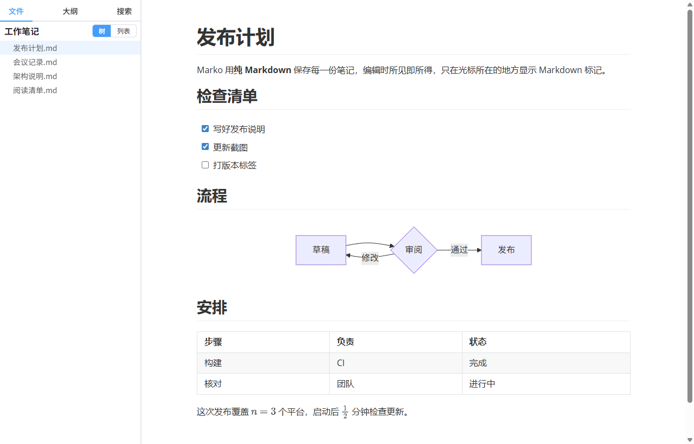

<p align="center">
  
</p>

<h1 align="center">Marko</h1>

<p align="center">
  <strong>一款面向专注写作的现代、本地优先 Markdown 编辑器。</strong>
</p>

<p align="center">
  在连续的可视化界面中编辑，同时让每份文档始终保持为可迁移的纯 Markdown 文件。
</p>

<p align="center">
  <a href="./README.md">English</a>
  ·
  <strong>简体中文</strong>
</p>

<p align="center">
  <a href="https://github.com/chain-code/Marko/releases/latest">
    
  </a>
  <a href="./LICENSE">
    
  </a>
  
  
  
  
</p>

<p align="center">
  <a href="https://github.com/chain-code/Marko/releases/latest"><strong>下载 Marko 2.0.0</strong></a>
  ·
  <a href="#功能概览">功能概览</a>
  ·
  <a href="#本地开发">从源码构建</a>
</p>



Marko 把可视化编辑与纯 Markdown 的可靠性放在一起。阅读时内容保持排版状态，只在正在编辑的地方显示 Markdown 语法；文件、目录、搜索、表格、图表、公式、图片和导出能力都集中在一个安静的桌面工作区中。

Marko 2.0 是重写的版本：桌面程序换成了 Electron，编辑器换成了基于 ProseMirror（Tiptap）的新内核。支持 Windows 10/11 x64、运行 macOS 13 或更高版本的 Apple Silicon Mac，以及 Linux x64。

## 为什么选择 Marko？

- **始终留在文档中** - 在一份连续内容中完成写作，不必来回切换源码与预览面板。
- **文件始终由你掌控** - 直接使用普通的本地 Markdown 文件和目录，并提供自动保存、草稿恢复和外部修改提示。
- **直接编辑富内容** - 在正文中编辑表格、代码、公式和图表，管理图片也不用离开文档。
- **长文档同样流畅** - 约 10 万字的文档打开约 0.2 秒，输入依然跟手。

## 图表与图片查看器

大型架构图、业务流程图和时序图很容易超出正文宽度。Marko 会在文档内渲染 Mermaid、Flowchart 与 Sequence 代码块，并允许你**双击任意已渲染的图表或图片，打开全窗口查看器**。


- 通过工具栏放大、缩小或一键重置。
- 用鼠标滚轮缩放，拖动查看各处细节。
- 使用 `+`、`-` 和 `0` 快速控制缩放。
- 在 40% 至 300% 之间查看细节，不会修改 Markdown 源码。
- 按 `Esc` 立即回到正文。

| 图表交互 | Marko | Typora 1.13.7 |
| --- | --- | --- |
| Mermaid、Flowchart 与 Sequence 文档内渲染 | 支持 | 支持 |
| 双击图表、图片打开全窗口查看器 | **内置支持** | 暂无 |
| 缩放与重置工具栏 | **内置支持** | 暂无 |
| 滚轮缩放、拖动查看 | **内置支持** | 暂无 |
| 键盘缩放与 `Esc` 快速关闭 | **内置支持** | 暂无 |

以上对比基于 Typora 1.13.7 的默认桌面行为。Marko 是独立项目，与 Typora 不存在隶属或关联关系。

## 下载

请前往 [GitHub Releases](https://github.com/chain-code/Marko/releases/latest) 获取安装包、校验文件和版本说明。

| 平台 | 系统要求 | 发布资源 |
| --- | --- | --- |
| Windows x64 | Windows 10 或 11 | NSIS `.exe` 安装包 |
| macOS ARM64 | Apple Silicon、macOS 13+ | `.dmg` 或 `-mac.zip` |
| Linux x64 | 较新的 x64 发行版 | `.AppImage` 或 `.deb` |

每个安装资源都提供对应的 SHA-256 校验文件。安装以后，新版本会在后台自动下载，下载完提示重启更新。

> [!IMPORTANT]
> Marko 2.0 不导入 1.x 的设置、最近文件和草稿。升级前请先保存所有文档。

> [!NOTE]
> 如果 macOS 安装包没有签名，首次打开时可能需要前往 **系统设置 > 隐私与安全性** 确认打开；这时 macOS 版也不能自动更新，新版本请到 GitHub Releases 下载。

## 功能概览

| 类别 | Marko 提供的能力 |
| --- | --- |
| 连续可视化编辑 | 内容保持排版，只在正在编辑的地方显示 Markdown 语法；跨块选择；连续输入合并撤销；完整的源码模式 |
| Markdown | 标题、引用、链接、任务列表、脚注、缩写、YAML Front Matter、`[TOC]`、GitHub 风格 Callout 和原始 HTML |
| 技术内容 | 代码高亮、带编号的 MathJax 公式、Mermaid、Flowchart、Sequence 时序图、高亮、上标和下标 |
| 表格 | 直接编辑单元格、行列操作、对齐设置，以及 `Tab` / `Shift+Tab` 导航 |
| 图片与媒体 | 粘贴、拖入图片，复制到文档旁边或上传到图床，设置宽度，插入视频和音频，双击查看大图 |
| 文件与工作区 | 一个窗口一个文档、文件树与文件列表、大纲、快速打开、最近文件、工作区搜索、本地链接，以及恢复上次的窗口 |
| 编码 | 自动识别编码，可以换一种编码重新打开，保留 BOM 和换行符 |
| 专注与安全 | 专注模式、打字机模式、全屏、缩放、拼写检查和用户词典、自动保存、草稿恢复和未保存确认 |
| 导出与导入 | 自带 HTML、PDF、长图和打印；通过 Pandoc 导出 Word、OpenDocument、RTF、EPUB、LaTeX、reStructuredText 和 MediaWiki，图表导出成图片；通过 Pandoc 导入 |
| 外观 | 浅色、深色两个内置主题，可以跟随系统深浅色，兼容 Typora 主题 |
| 个性化 | 自定义快捷键，中文和英文界面 |

HTML、PDF、长图和打印不需要额外的软件。通过 Pandoc 导出的格式需要在本机安装 [Pandoc](https://pandoc.org/)。

<details>
<summary><strong>常用快捷键</strong></summary>

下表中的 `Ctrl` 在 macOS 中对应 `Command`。所有快捷键都可以在 **偏好设置 > 快捷键** 中修改。

| 操作 | 快捷键 |
| --- | --- |
| 新建 / 打开 / 保存 | `Ctrl+N` / `Ctrl+O` / `Ctrl+S` |
| 另存为 | `Ctrl+Shift+S` |
| 快速打开 | `Ctrl+P` |
| 查找 / 替换 | `Ctrl+F` / `Ctrl+H`（macOS 上是 `Command+Option+F`） |
| 工作区全文搜索 | `Ctrl+Shift+F` |
| 源码模式 | `Ctrl+/` |
| 显示或隐藏侧边栏 | `Ctrl+Shift+L` |
| 专注模式 / 打字机模式 | `F8` / `F9` |
| 全屏 | `F11`（macOS 上是 `Control+Command+F`） |
| 打印 | `Shift+Alt+P` |

</details>

## 本地开发

<details>
<summary><strong>环境要求、本地运行、测试与打包</strong></summary>

### 环境要求

Node.js 24，npm 10 或更高版本。不需要别的工具链：Electron、ripgrep 和原生的文件监听模块都由 npm 安装。

### 本地运行

```bash
npm ci
npm run dev
```

`npm run dev` 启动 Electron 应用，改代码后自动刷新。

### 测试

```bash
npm run check             # 类型检查和依赖方向
npm test                  # 单元测试、行为规格和组件测试
npm run test:e2e          # 在构建好的应用上跑端到端测试
npm run test:interaction  # 在 Microsoft Edge 里跑编辑器的交互测试
npm run test:e2e:packaged # 在打好的包上跑端到端测试
```

### 打包

```bash
# 当前平台的免安装目录
npm run pack

# 当前平台的安装包
npm run dist
```

打包结果在 `apps/desktop/release`。每个平台要在各自的系统上打包；推送版本号标签时，发布流程会分别打出 Windows、macOS 和 Linux 的安装包。

### 目录结构

| 路径 | 内容 |
| --- | --- |
| `packages/markdown` | Markdown 解析、文档模型和无损序列化 |
| `packages/render` | HTML 渲染、过滤、公式、代码高亮、图表沙箱和自包含导出 |
| `packages/editor` | 编辑器内核（Tiptap 扩展） |
| `packages/editor-vue` | Vue 编辑器组件和它的浮层 |
| `packages/themes` | 排版、编辑区和界面的样式，以及内置主题 |
| `packages/shared` | 设置、快捷键，以及进程之间的接口 |
| `apps/desktop` | Electron 应用：主进程、预加载脚本和界面 |

</details>

<details>
<summary><strong>技术栈</strong></summary>

- Electron、Vue 3、TypeScript、Element Plus 和 electron-vite
- Tiptap（ProseMirror）、CodeMirror 6 和 Lezer Markdown
- MathJax、Mermaid、flowchart.js 和 @hackmd/js-sequence-diagrams
- electron-builder 和 electron-updater
- Vitest、Vue Test Utils、Playwright 和 dependency-cruiser

</details>

## 参与贡献

欢迎提交 Issue 和 Pull Request。报告问题时，请附上 Marko 版本、操作系统、最小 Markdown 示例、清晰的复现步骤；如果是界面表现问题，也请附上截图或简短录屏。

提交 Pull Request 前请运行：

```bash
npm run verify
```

请保持改动聚焦，并为行为变化补充回归测试。架构见 [docs/architecture.md](./docs/architecture.md)，完整的功能清单见 [docs/features.md](./docs/features.md)。

如果 Marko 让你的写作流程更顺手，欢迎为仓库点一个 Star，让更多 Markdown 用户发现这个项目。

## 许可证

Marko 以 [MIT License](./LICENSE) 发布。

Copyright (c) 2026 chain-code.
