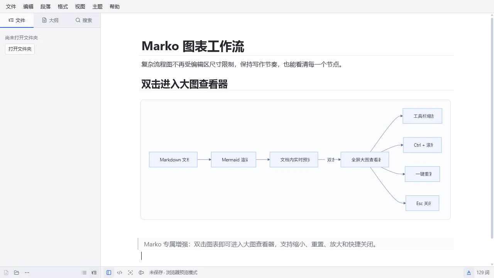
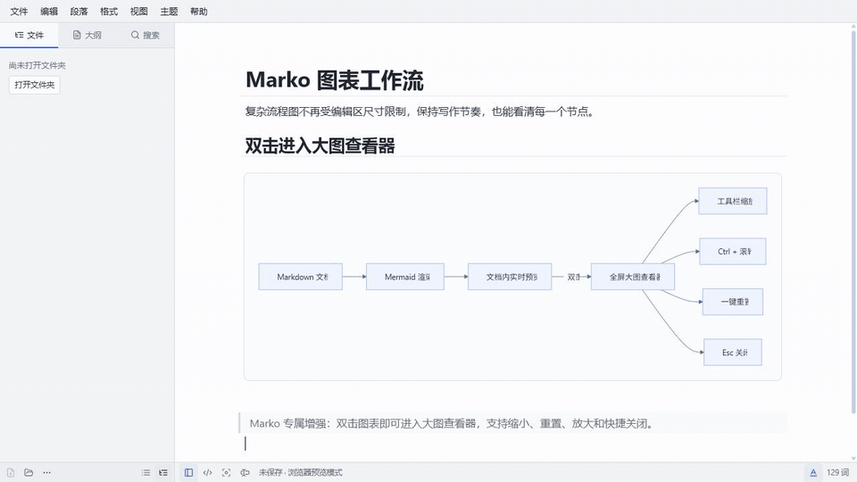

<p align="center">
  
</p>

<h1 align="center">Marko</h1>

<p align="center">
  <strong>一款面向专注写作的现代、本地优先 Markdown 编辑器。</strong>
</p>

<p align="center">
  在连续的可视化界面中编辑，同时让每份文档始终保持为可迁移的纯 Markdown 文件。
</p>

<p align="center">
  <a href="./README.md">English</a>
  ·
  <strong>简体中文</strong>
</p>

<p align="center">
  <a href="https://github.com/chain-code/Marko/releases/latest">
    
  </a>
  <a href="./LICENSE">
    
  </a>
  
  
  
</p>

<p align="center">
  <a href="https://github.com/chain-code/Marko/releases/latest"><strong>下载 Marko 1.1.0</strong></a>
  ·
  <a href="#功能概览">功能概览</a>
  ·
  <a href="#本地开发">从源码构建</a>
</p>



Marko 把可视化编辑与纯 Markdown 的可靠性放在一起。阅读时内容保持排版状态，光标进入后才显示对应的 Markdown 语法；文件、目录、搜索、表格、图表、公式、图片和导出能力都集中在一个安静的桌面工作区中。

当前支持 Windows 10/11 x64，以及运行 macOS 11 或更高版本的 Apple Silicon Mac。

## 为什么选择 Marko？

- **始终留在文档中** - 在一份连续内容中完成写作，不必来回切换源码与预览面板。
- **文件始终由你掌控** - 直接使用普通的本地 Markdown 文件，并提供目录、搜索、自动保存和草稿恢复。
- **直接编辑富内容** - 在正文中编辑可视化表格、查看复杂图表、编写 MathJax 公式和管理图片。
- **保持专注的工作区** - 写作时可使用文件树、大纲、快速打开、专注模式、打字机模式和文档统计。

## 图表大图查看器

大型架构图、业务流程图和时序图很容易超出正文宽度。Marko 会在文档内渲染 Mermaid、Flowchart 与 Sequence 代码块，并允许你**双击任意已渲染图表，打开独立的全窗口大图查看器**。



这个查看器专门面向真实的技术文档：

- 通过悬浮工具栏放大、缩小或一键重置。
- 使用 `Ctrl + 滚轮` 连续缩放。
- 使用 `+`、`-` 和 `0` 快速控制缩放。
- 在 40% 至 300% 之间查看细节，不会修改 Markdown 源码。
- 按 `Esc` 立即回到正文。

### Typora 尚未提供的图表工作流

| 图表交互 | Marko | Typora 1.13.7 |
| --- | --- | --- |
| Mermaid、Flowchart 与 Sequence 文档内渲染 | 支持 | 支持 |
| 双击打开全窗口大图查看器 | **内置支持** | 暂无 |
| 独立的缩放与重置工具栏 | **内置支持** | 暂无 |
| 查看器内 `Ctrl + 滚轮` 缩放 | **内置支持** | 暂无 |
| 键盘缩放与 `Esc` 快速关闭 | **内置支持** | 暂无 |

以上对比基于 Typora 1.13.7 的默认桌面行为。Marko 是独立项目，与 Typora 不存在隶属或关联关系。

## 下载

请前往 [GitHub Releases](https://github.com/chain-code/Marko/releases/latest) 获取安装包、校验文件和版本说明。

| 平台 | 系统要求 | 发布资源 |
| --- | --- | --- |
| Windows x64 | Windows 10 或 11 | NSIS `.exe` 安装包 |
| macOS ARM64 | Apple Silicon、macOS 11+ | `.dmg` 或 `.app.zip` |

每个安装资源都提供对应的 SHA-256 校验文件。

> [!NOTE]
> 当前 macOS 构建尚未签名，并且仅支持 Apple Silicon。首次启动时，可能需要前往 **系统设置 > 隐私与安全性** 确认打开。

## 功能概览

| 类别 | Marko 提供的能力 |
| --- | --- |
| 连续可视化编辑 | 非活动内容保持渲染、当前位置显示源码、跨块选择、统一撤销，以及可随时启用的完整源码模式 |
| Markdown | 标题、引用、链接、任务与定义列表、脚注、YAML Front Matter、`[TOC]`、GitHub 风格 Callout 和原始 HTML |
| 技术内容 | 代码高亮、MathJax 公式、Mermaid、Flowchart、Sequence 时序图、上标、下标、高亮和自动链接 |
| 可视化表格 | 直接编辑单元格、行列操作、对齐设置、矩阵粘贴，以及 `Tab` / `Shift+Tab` 导航 |
| 图片 | 相对路径预览、拖拽与粘贴、宽度设置、本地保存策略、上传接口，以及双击大图查看 |
| 文件与工作区 | 文件树与列表、大纲、快速打开、最近文件、工作区搜索、本地链接和文档锚点 |
| 专注与安全 | 专注模式、打字机模式、原生全屏、缩放、拼写检查、自动保存、草稿恢复和未保存确认 |
| 统计与导出 | 字数、字符、阅读时间、光标与选区统计、打印，以及基于 Pandoc 的多格式导出 |

Pandoc 导出支持 PDF、HTML、DOCX、RTF 和 EPUB，需要在本机安装 [Pandoc](https://pandoc.org/)。PDF 导出还需要 Pandoc 可用的 PDF 引擎，通常为 LaTeX 环境。

<details>
<summary><strong>常用快捷键</strong></summary>

下表中的 `Ctrl` 在 macOS 中对应 `Command`。

| 操作 | 快捷键 |
| --- | --- |
| 新建 / 打开 / 保存 | `Ctrl+N` / `Ctrl+O` / `Ctrl+S` |
| 另存为 | `Ctrl+Shift+S` |
| 快速打开 | `Ctrl+P` |
| 查找 / 替换 | `Ctrl+F` / `Ctrl+H` |
| 工作区全文搜索 | `Ctrl+Shift+F` |
| 源码模式 | `Ctrl+/` |
| 显示或隐藏侧边栏 | `Ctrl+Shift+L` |
| 专注模式 / 打字机模式 | `F8` / `F9` |
| 原生全屏 | `F11` |
| 打印 | `Shift+Alt+P` |

</details>

## 本地开发

<details>
<summary><strong>环境要求、本地运行、测试与打包</strong></summary>

### 环境要求

前端开发需要 Node.js 20、22 或 24+，以及 npm 10 或兼容版本。

桌面开发还需要 Rust stable，并确保终端可以执行 `cargo`。

Windows 构建需要 Rust `x86_64-pc-windows-msvc` 目标、Visual Studio 2022 Build Tools 的“使用 C++ 的桌面开发”工作负载、Windows 10/11 SDK，以及 Microsoft Edge WebView2 Evergreen Runtime。

Apple Silicon macOS 构建需要 macOS 11+、Xcode Command Line Tools，以及 Rust `aarch64-apple-darwin` 目标。

### 本地运行

```bash
npm ci
npm run tauri:dev
```

`tauri:dev` 会自动启动 Vite 并打开桌面应用。

只调试浏览器界面和 Markdown 交互：

```bash
npm run dev
```

随后访问 `http://127.0.0.1:1420`。原生文件系统、窗口和桌面导出能力需要 Tauri 桌面模式。

### 测试

```bash
# 前端逻辑、类型和组件测试
npm test

# Rust 测试
cargo test --manifest-path src-tauri/Cargo.toml

# 完整校验，包括生产构建
npm run verify
```

项目包含 700 多项自动化测试，覆盖编辑逻辑、Markdown 行为、Vue 组件、桌面端 Rust 代码和关键回归场景。

### 构建

```bash
# 前端资源
npm run build

# 当前平台桌面应用
npm run tauri:build

# Windows x64 NSIS 安装包
npm run pack:win

# Apple Silicon 应用与 DMG，需要在 macOS 上执行
rustup target add aarch64-apple-darwin
npm run pack:mac-arm
```

安装包产物路径：

- Windows：`src-tauri/target/x86_64-pc-windows-msvc/release/bundle/nsis/*-setup.exe`
- macOS：`src-tauri/target/aarch64-apple-darwin/release/bundle/dmg/*.dmg` 与 `bundle/macos/*.app`

macOS 产物必须在 macOS 上构建。面向普通用户公开分发时，还需要 Apple Developer ID 签名与公证；本地开发构建不需要。

</details>

<details>
<summary><strong>技术栈</strong></summary>

- Vue 3、TypeScript 与 Vite
- CodeMirror 6 与 markdown-it
- highlight.js 与 MathJax
- Mermaid、flowchart.js 与 @hackmd/js-sequence-diagrams
- Tauri 2 与 Rust
- Node.js Test Runner、Vitest、Vue Test Utils 与 vue-tsc

</details>

## 参与贡献

欢迎提交 Issue 和 Pull Request。报告问题时，请提供 Marko 版本、操作系统、可复现问题的最小 Markdown 内容、清晰的操作步骤，以及视觉问题所需的截图或短录屏。

提交 Pull Request 前请运行：

```bash
npm run verify
```

请保持改动范围明确，并为行为变更补充回归测试。计划中和暂缓的事项记录在[待办清单](./TODO.md)中。

如果 Marko 改善了你的写作流程，欢迎为项目点一个 Star，让更多 Markdown 用户发现它。

## 许可证

Marko 使用 [MIT License](./LICENSE) 发布。

版权所有 (c) 2026 chain-code。
