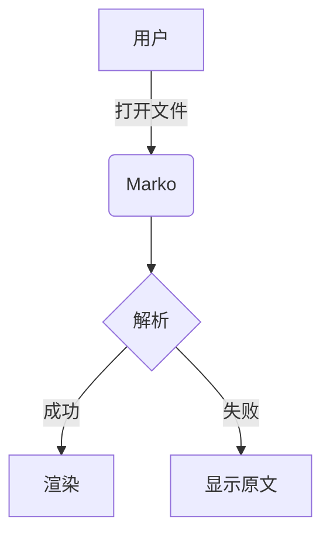
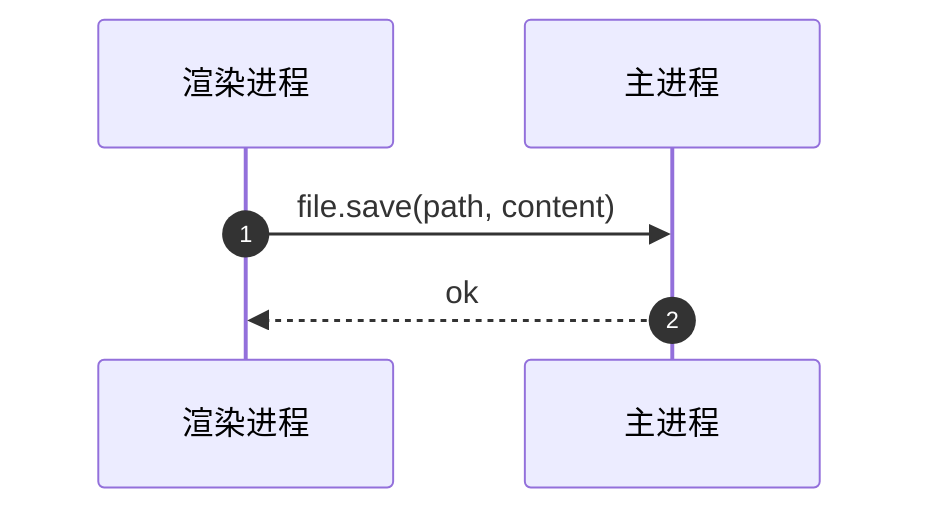
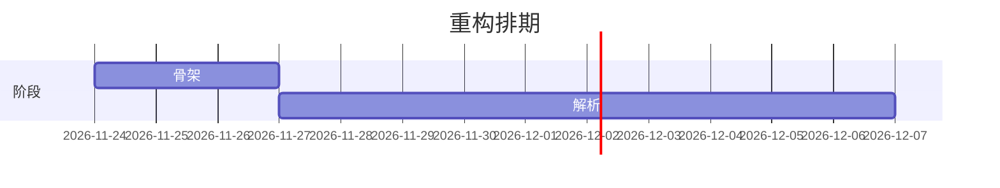
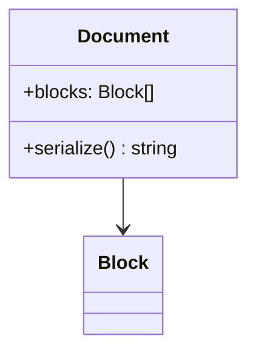

# 系统设计图









```flow
st=>start: 开始
op=>operation: 读取文件
cond=>condition: 是 Markdown？
e=>end: 打开
st->op->cond
cond(yes)->e
cond(no)->op
```

```sequence
Title: 保存
Editor->Main: save
Main-->Editor: done
```
