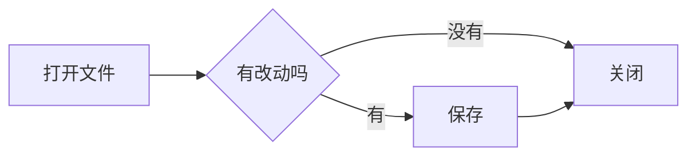
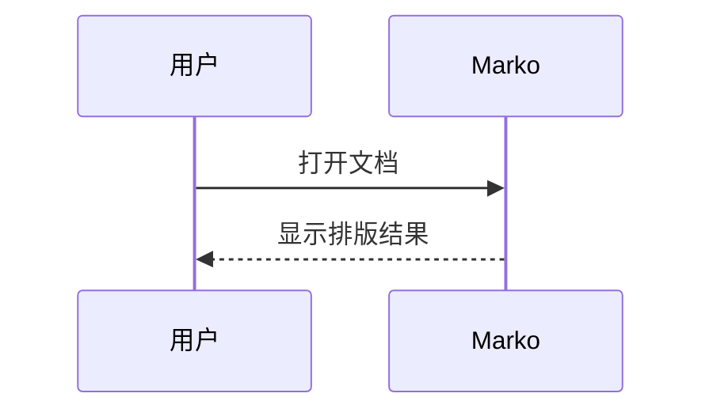

# 图表

## Mermaid 流程图



## Mermaid 时序图



## Flowchart

```flow
st=>start: 开始
op=>operation: 处理
cond=>condition: 成功？
e=>end: 结束
st->op->cond
cond(yes)->e
cond(no)->op
```

## Sequence

```sequence
Alice->Bob: Hello Bob, how are you?
Note right of Bob: Bob thinks
Bob-->Alice: I am good thanks!
```
